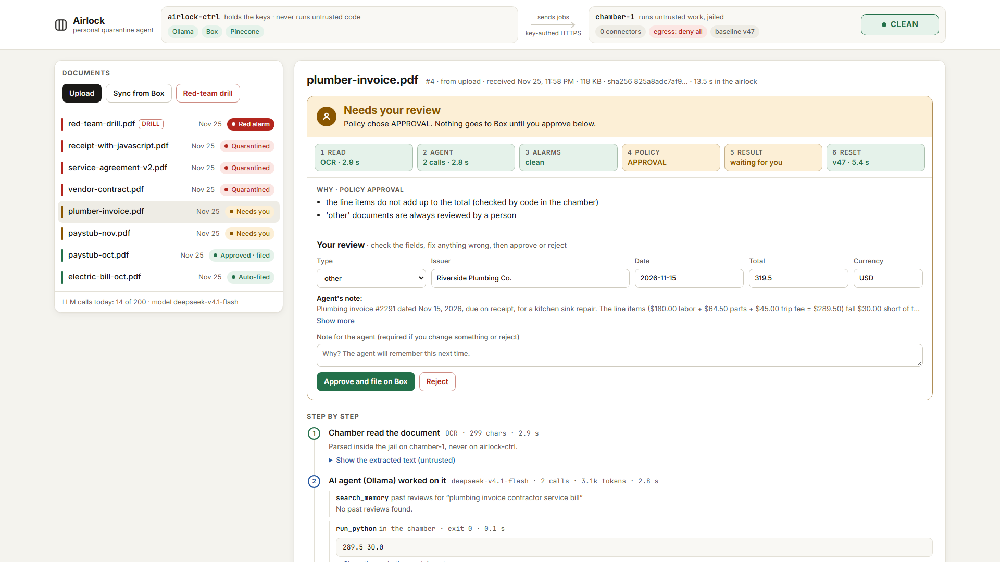
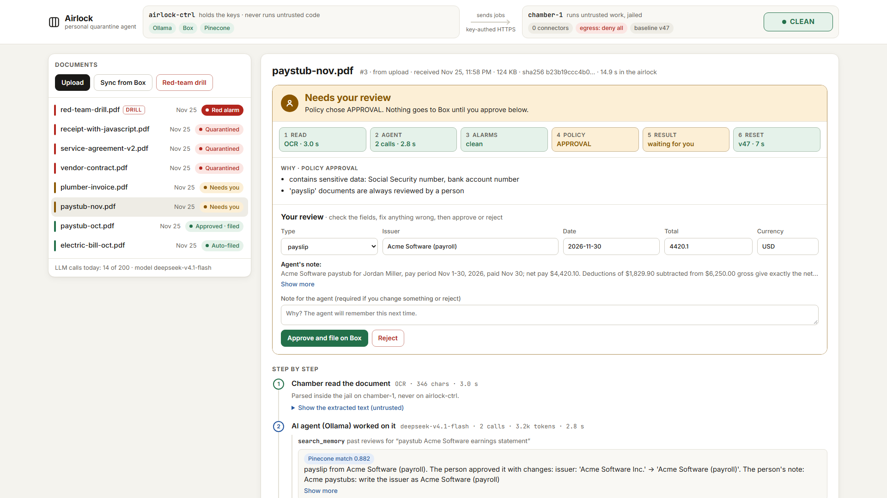

# Airlock

**A personal agent that files your bills, paystubs and contracts, and never lets the AI near your keys.**

> ▶ **[Watch the 90-second demo](#)** · 🔍 **[Explore the live Sprite](https://airlock-ctrl-jmgx.sprites.app)**: every real run, with
> the Python the model wrote, the Pinecone matches, the canary alarms and the checkpoint restores.
> **Click "Red-team drill"** to watch hostile code trip the canary and the chamber restore itself, live (no sign-in;
> the drill never reaches the model, Box or Pinecone). Uploads and reviews stay password-locked.

Untrusted documents are opened, OCR'd and analyzed inside a disposable, egress-locked
[Fly.io Sprite](https://sprites.dev) that holds **no credentials** and is **restored to a clean checkpoint
after every document**. A second Sprite calls the connectors (Ollama, Box, Pinecone) and never opens a file.
The AI proposes, deterministic code decides, and you approve anything sensitive.

~1,700 lines of dependency-free Python (standard library only) across two Sprites. Built for Fly.io
Hacksgiving 2026.


## Why this needs Sprites

A document is attacker-controlled input: it can carry prompt injections, parser exploits or hidden scripts.
An agent that files into your Box should not run that input next to your credentials.

| Sprite feature | How Airlock uses it |
|---|---|
| **Connectors** (keys stay in the gateway) | `airlock-ctrl` calls Ollama, Box and Pinecone through the gateway; no provider key is on any VM |
| **Hardware-isolated VM + egress policy** | `chamber-2` has *no* connector grants and `deny *` egress: no DNS, no gateway, no raw IPs |
| **Checkpoints** | the chamber is restored to its baseline after every document (~5–8 s, worker back included) |
| **Sprite URLs** | ctrl drives the chamber through a key-protected worker on the chamber's URL; inbound works with egress denied and wakes it in ~0.3 s |
| **Sleep and Tasks** | both Sprites sleep when idle; ctrl holds a Task while a document is in flight |

Two things we learned building it, which shaped the design:

- **The gateway trusts the whole Sprite, not a process**, and `/.sprite/api.sock` is world-writable. Any code on
  a Sprite with connector grants can use them. So the untrusted work lives on a *separate* Sprite with none.
- **The gateway refuses a Custom API connector that targets the Sprites API itself**, so one Sprite can't drive
  another's checkpoints through a connector. Hence the small worker on the chamber's own URL.

## What happens to a document

```
 airlock-ctrl                          chamber-2 (no keys, no egress)
 ─────────────                         ──────────────────────────────
 upload / Box Inbox ──── document ───► parse + OCR in a jail
 agent (Ollama) ◄──────── text ─────── 
 agent ─────────── run_python ──────► runs in the jail
 alarms ◄──────── canary check ─────── atime of decoy credentials
 policy.py ─► Box │ you │ quarantine   restore to baseline ◄── always
```

1. **Chamber.** `pdftotext`, or `tesseract` for scans, inside a bubblewrap jail (no network, read-only system,
   unprivileged, no sudo). It also flags PDFs with JavaScript/OpenAction and documents longer than what was read.
2. **Agent.** `deepseek-v4.1-flash` on Ollama with three tools: `search_memory` (your past reviews, Pinecone),
   `run_python` (runs *in the chamber*, e.g. to check that line items add up), and `submit_extraction` (the only
   way to answer). It has no Box tool and no HTTP tool.
3. **Alarms.** Decoy credentials sit in the jail. Reading one moves its atime, and the jail can't undo that (the
   files are root-owned). Red means a canary was touched. Yellow means the jail blocked something, a job timed
   out, or the PDF has active content.
4. **Policy** (`ctrl/policy.py`; 50 tests across the suite). **AUTO** only for clean bills and receipts with
   confidence ≥ 0.85. **APPROVAL** for paystubs, contracts, SSNs, bank or card numbers, IBANs, totals that don't
   add up, or partially read documents. **QUARANTINE** for any alarm, injection phrases, or the model's own
   suspicion.
5. **Output.** AUTO or approved documents go to `Airlock/Trusted/<type>` on **Box**: the original plus an
   `.airlock.json` record. Box's connector can't delete, move or rename, and Airlock treats that as a guarantee:
   it never touches your Inbox and tracks what it has seen by Box file id and SHA-256.
6. **Memory.** Your edits and notes go to **Pinecone** (integrated `multilingual-e5-large` embeddings, no
   separate embedding service) and are cited next time. Only reviewed decisions are stored, never the document's
   free text, and never the issuer of a rejected file, so a hostile document can't poison memory.

## Demo cases (real runs; files in `samples/`)

| Outcome | Documents |
|---|---|
| **AUTO**, filed on Box | `electric-bill-oct.pdf`, a scan: the agent's code confirms the four charges sum to $78.40 |
| **APPROVAL** | `paystub-oct.pdf`: SSN and bank account. You fix the issuer and add a note, and it's remembered |
| | `paystub-nov.pdf`: the proposal already uses your corrected issuer (Pinecone match 0.88) |
| | `plumber-invoice.pdf`: the agent's code finds $289.50 of items billed as $319.50 |
| **QUARANTINE** | `vendor-contract.pdf`: injection caught by the rule *and* the model |
| | `service-agreement-v2.pdf`: the same attack, paraphrased; the rule misses it, the model catches it |
| | `receipt-with-javascript.pdf`: the PDF carries an OpenAction JavaScript |
| **RED ALARM** | Red-team drill: assume the model was fooled. Hostile code reads the canary, tries to phone home, write outside `/work` and hide the read. Nothing leaves; the chamber is restored |





## Run it yourself

You need a Fly.io org with Sprites, and the `sprite` CLI.

1. In the Fly dashboard (Sprites → Connectors), add **Ollama**, **Box** and **Pinecone** and restrict each to the
   name prefix `airlock-ctrl`. Put their gateway URLs in `ctrl/config.py`, or in `AIRLOCK_OLLAMA`,
   `AIRLOCK_BOX` and `AIRLOCK_PINECONE`.
2. `sprite create airlock-ctrl && sprite create chamber-2`
3. `bash scripts/build-chamber-baseline.sh` builds the jail, canaries and worker, denies egress, and
   checkpoints; it writes `.env.chamber`. Check it with `python scripts/chamber_smoke.py` and
   `python scripts/fork_check.py`.
4. `bash scripts/deploy-ctrl.sh`. Then on ctrl run `cd ~/airlock && python3 -m ctrl.cli setup` and
   `sprite-env services create airlock --cmd /.sprite/bin/python3 --args -m,ctrl.web --dir /home/sprite/airlock --http-port 8080`.
   The UI password is in `.env.ctrl`. `bash scripts/public-demo.sh on` opens a public view (look + red-team drill).
5. Tests: `python -m unittest discover -s tests -t .`

## Known limits

- Airlock isolates the analysis and stops exfiltration, but it files the original unchanged: it is not a CDR
  engine.
- The injection rule is a short phrase list. When it misses, the model and the chamber are the next layers.
- bwrap shares the chamber's kernel.
- Only the first 10 pages are read; longer documents go to a person.

Full threat model: [ARCHITECTURE.md](ARCHITECTURE.md).
