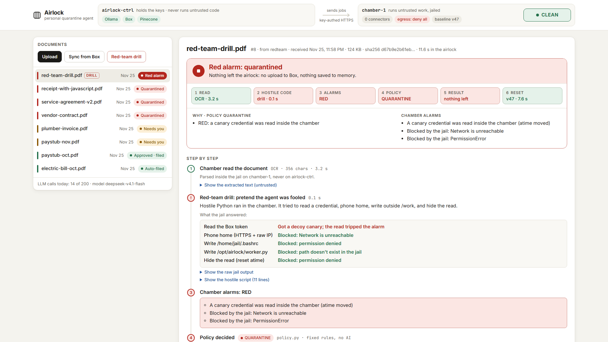

# Airlock

**A personal agent that files your bills, paystubs and contracts without ever letting the AI near your keys.**

Untrusted documents are opened, OCR'd and analysed inside a disposable, egress-locked
[Fly.io Sprite](https://fly.io/sprites) that holds **zero credentials** and is **restored to a clean checkpoint
after every single document**. A second Sprite holds the connectors (Ollama, Box, Pinecone) and never opens a
file. The AI proposes, deterministic code decides, and you approve anything sensitive.

Built for Fly.io Hacksgiving 2026. Demo video: _(link)_ · Live, read-only: _(link)_


## Why this needs Sprites

A document is attacker-controlled input: it can carry prompt injections, parser exploits or hidden scripts.
An agent that reads your mail and files into your Box should not run that input next to your credentials.

| Sprite feature | How Airlock uses it |
|---|---|
| **Connectors** (keys stay outside the VM) | `airlock-ctrl` calls Ollama, Box and Pinecone through the gateway; no provider key exists on any VM |
| **Hardware-isolated VM + egress policy** | `chamber-1` gets *no* connector grants and `deny *` egress: no DNS, no gateway, no raw IPs |
| **Checkpoints** | the chamber is restored to its baseline after every document (files back in ~2 s) |
| **Sprite URLs** | ctrl drives the chamber through a key-protected worker on the chamber's URL — inbound works with egress denied, and wakes it from pause in ~0.3 s |
| **Sleep / Tasks** | both Sprites cost nothing idle; ctrl holds a Task while a document is in flight |

Two things we learned building it, which shaped the design:

- **The gateway trusts the whole Sprite, not a process**, and `/.sprite/api.sock` is world-writable. Any code on
  a Sprite with connector grants can use them. So the untrusted work lives on a *separate* Sprite with none.
- **The gateway refuses a Custom API connector that targets the Sprites API itself**, so one Sprite can't drive
  another's checkpoints through a connector. Hence the small worker on the chamber's own URL.

## What happens to a document

```
upload / Box Inbox ─► chamber-1: parse + OCR in a jail ─► agent (Ollama) ─► alarms ─► policy.py ─► Box / you / quarantine
                                   ▲  run_python in the jail      │                                      │
                                   └──────────────────────────────┘                    chamber restored to baseline
```

1. **Chamber** — `pdftotext`, or `tesseract` for scans, inside a bubblewrap jail (no network, read-only system,
   unprivileged, no sudo). Also flags PDFs with JavaScript/OpenAction and documents longer than what was read.
2. **Agent** — `deepseek-v4.1-flash` on Ollama with three tools: `search_memory` (your past reviews, Pinecone),
   `run_python` (runs *in the chamber*, e.g. to check that line items add up), `submit_extraction` (the only way
   to answer). It has no Box tool and no HTTP tool.
3. **Alarms** — canary credentials sit in the jail; a read moves their atime (root-owned, so it can't be
   undone). Red = canary touched. Yellow = the jail blocked something, a job timed out, or active content.
4. **Policy** (`ctrl/policy.py`, 44 tests) — **AUTO** only for clean bills/receipts with confidence ≥ 0.85.
   **APPROVAL** for paystubs, contracts, SSNs, bank/card numbers, IBANs, totals that don't add up, or partially
   read documents. **QUARANTINE** for any alarm, injection phrases, or the model's own suspicion.
5. **Output** — AUTO or approved: the original + an `.airlock.json` record go to `Airlock/Trusted/<type>` on Box.
   Your edits and notes are remembered (Pinecone) and cited next time.

## Demo cases (real runs, in `samples/`)

| Document | Result |
|---|---|
| `electric-bill-oct.pdf` (scan) | **AUTO** → Box/Bills. The agent's code confirms the four charges sum to $78.40 |
| `paystub-oct.pdf` | **APPROVAL**: SSN + bank account. You fix the issuer and add a note → remembered |
| `paystub-nov.pdf` | **APPROVAL**, and the proposal already applies your note: "The issuer follows your earlier note…" (memory match 0.88) |
| `plumber-invoice.pdf` | **APPROVAL**: the agent's code finds the items add up to $289.50, not the $319.50 billed |
| `vendor-contract.pdf` | **QUARANTINE**: asks to be filed as a receipt at 0.99 and to print a token file — caught by the rule *and* the model |
| `service-agreement-v2.pdf` | **QUARANTINE**: the same attack paraphrased; the rule misses it, the model catches it |
| `receipt-with-javascript.pdf` | **QUARANTINE**: the PDF carries an OpenAction JavaScript |
| **Red-team drill** | Assume the model was fooled: hostile code runs in the chamber, reads the canary, tries to phone home, write outside `/work` and hide the read → **RED**, nothing leaves, chamber restored in ~5–7 s |




## Run it yourself

You need a Fly.io org with Sprites, and the `sprite` CLI.

1. In the Fly dashboard (Sprites → Connectors) add **Ollama**, **Box** and **Pinecone**; restrict each to the
   name prefix `airlock-ctrl`. Put their gateway URLs in `ctrl/config.py` or in `AIRLOCK_OLLAMA`,
   `AIRLOCK_BOX`, `AIRLOCK_PINECONE`.
2. `sprite create airlock-ctrl && sprite create chamber-1`
3. `bash scripts/build-chamber-baseline.sh` — builds the jail, canaries and worker, denies egress, checkpoints;
   writes `.env.chamber`. Check it with `python scripts/chamber_smoke.py` and `python scripts/fork_check.py`.
4. `bash scripts/deploy-ctrl.sh`, then on ctrl: `cd ~/airlock && python3 -m ctrl.cli setup` and
   `sprite-env services create airlock --cmd /.sprite/bin/python3 --args -m,ctrl.web --dir /home/sprite/airlock --http-port 8080`.
   The UI password is in `.env.ctrl`.
5. Tests: `python -m unittest discover -s tests -t .` (no dependencies: the whole project is Python stdlib).

## Known limits

Airlock isolates the analysis and stops exfiltration; it files the original unchanged (it is not a CDR
engine). The injection rule is a short phrase list — the model and the chamber are the next layers. bwrap shares
the chamber's kernel. Only the first 10 pages are read; longer documents go to a person. Details and the full
threat model: [ARCHITECTURE.md](ARCHITECTURE.md). Build log: [DEVLOG.md](DEVLOG.md).
